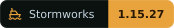
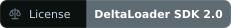

<div align="center">

# DeltaLoader native mod SDK

**Build your own C++ mods for _Stormworks: Build and Rescue_ and run them with the DeltaLoader.**

<a href="https://discord.gg/HH3ezeD8BD"></a>
<a href="https://stormworks-tools.com/"></a>
<a href="https://deltav-modding.github.io/DeltaLoader/"></a>
<a href="https://stormworks-tools.com/download"></a>
<br>



<a href="LICENSE"></a>

[Discord](https://discord.gg/HH3ezeD8BD) · [Website](https://stormworks-tools.com/) · [Documentation](https://deltav-modding.github.io/DeltaLoader/) · [Mods](https://stormworks-tools.com/mods) · [Server loader](https://stormworks-tools.com/server)

</div>

---

Welcome! This is the source code that lets you build your own mods for the DeltaLoader. Most of it was written by Malionaro
(basically everything); the example mod was written by Shayans.

## What you can do with it

| Area | Headers |
|---|---|
| The mod skeleton, hooks, the game's functions by name | `mod.hpp`, `hook.hpp`, `runtime.hpp`, `game.hpp`, `events.hpp` |
| World, islands, tiles, your own start card | `world.hpp`, `tiles.hpp`, `start_tiles.hpp` |
| Vehicles, physics, weather, input, audio, network | `vehicle.hpp`, `physics.hpp`, `weather.hpp`, `input.hpp`, `audio.hpp`, `network.hpp` |
| Graphics: the render pipeline, your own shader uniforms and textures | `render.hpp`, `shader.hpp` |
| Shader `#define` settings, GLSL 460, rebuilding shaders while the game runs | `shader_build.hpp` |
| **Post-processing effects** over the finished picture (a small `.glsl` file per effect) | `postfx.hpp` |
| Where clouds appear | `clouds.hpp` |
| Textures, meshes, flags, map icons, the user interface | `textures.hpp`, `mesh.hpp`, `flags.hpp`, `mapicons.hpp`, `ui.hpp` |

Every header says in its first lines what is proven and what is not. The full API reference is in the
[documentation](https://deltav-modding.github.io/DeltaLoader/reference/overview/).

## Ready-made mods in this repository

| Target | What it does |
|---|---|
| `delta_example` | The example mod - start here. |
| `shader_config` | Shader `#define` settings and the GLSL version from an ini file, applied while the game runs (Ctrl+F8); post-processing effects from presets and your own `.glsl` files (Ctrl+F7). |
| `cloud_control` | Decide where clouds appear, from an ini file (Ctrl+F9). |

Players: see [Shader settings and clouds](https://deltav-modding.github.io/DeltaLoader/players/shaders-and-clouds/).

## Requirements

- Windows x64
- CMake 3.20 or newer
- Visual Studio 2022 with the C++ workload (MSVC)

## Build

```powershell
.\build_mod.ps1
```

The DLLs are in `build-mod\Release`.

## Add a mod

Add a `.cpp` file with `#include "sw/mod.hpp"`, `SW_MOD("your_mod")`, `sw_mod_start()` and `sw_mod_stop()`, then register it
in `CMakeLists.txt`:

```cmake
sw_add_mod(your_mod src/your_mod.cpp)
```

The [first mod guide](https://deltav-modding.github.io/DeltaLoader/developer/first-mod/) walks through it. When it works,
publish it on [stormworks-tools.com](https://stormworks-tools.com/) so players can install it with one click in the launcher.

## Support

Questions, bugs or ideas? Join us on [**Discord**](https://discord.gg/HH3ezeD8BD) - we are happy to help. Bugs and feature
requests can also go into the [issues](https://github.com/DeltaV-Modding/DeltaLoader/issues).

## License

DeltaLoader Native Mod SDK License 2.0 - see [LICENSE](LICENSE).

Stormworks: Build and Rescue is a game by Geometa. This project is not affiliated with or endorsed by Geometa.
